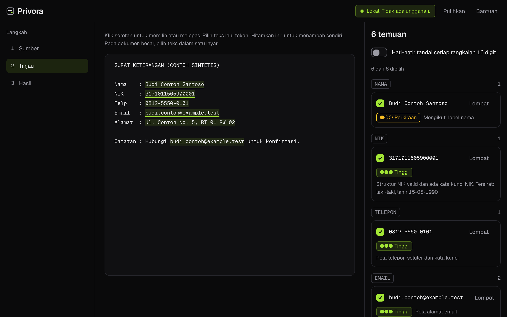
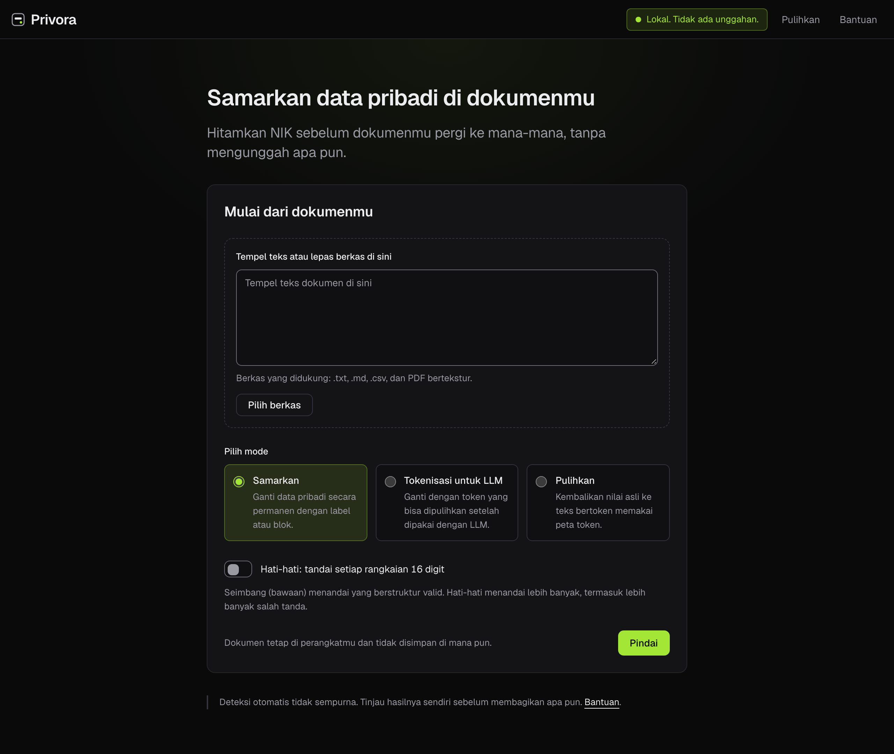
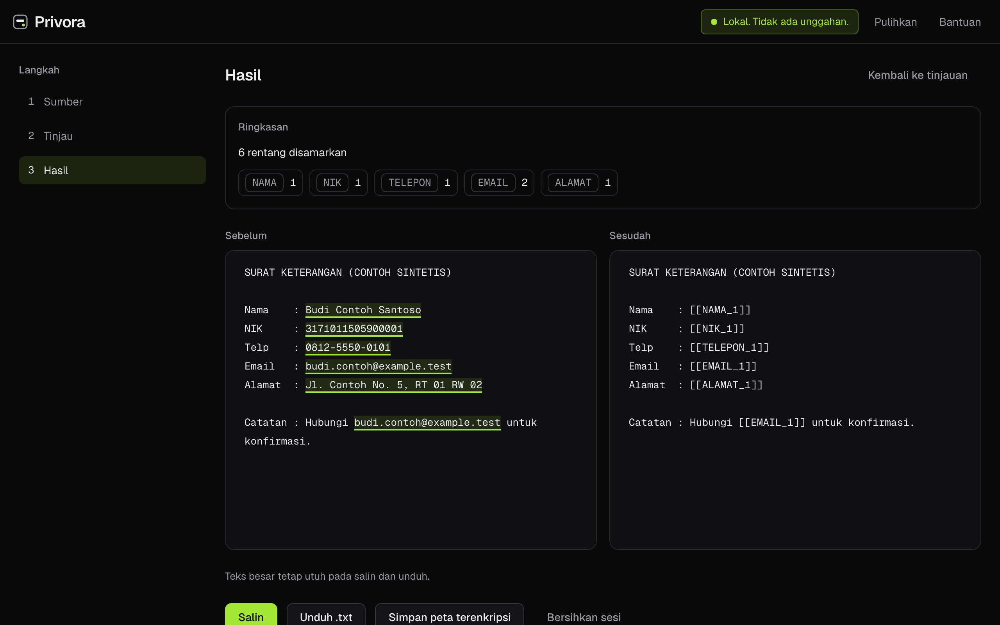
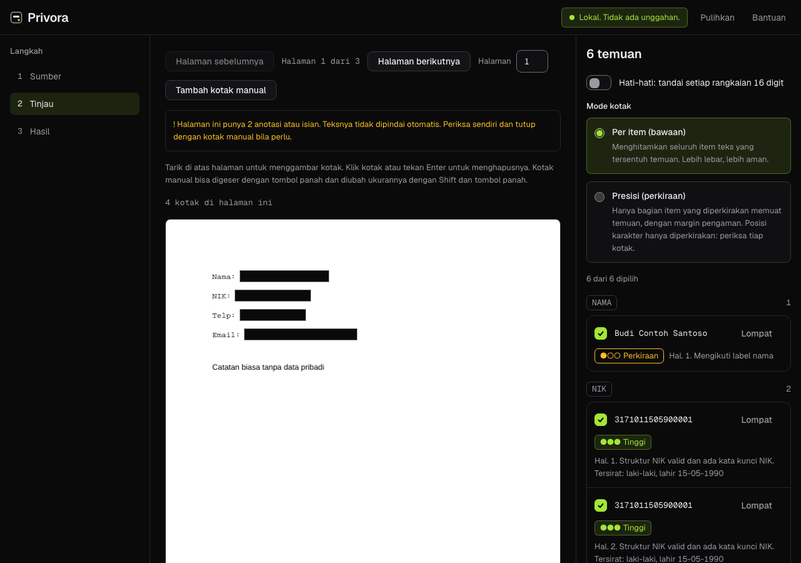
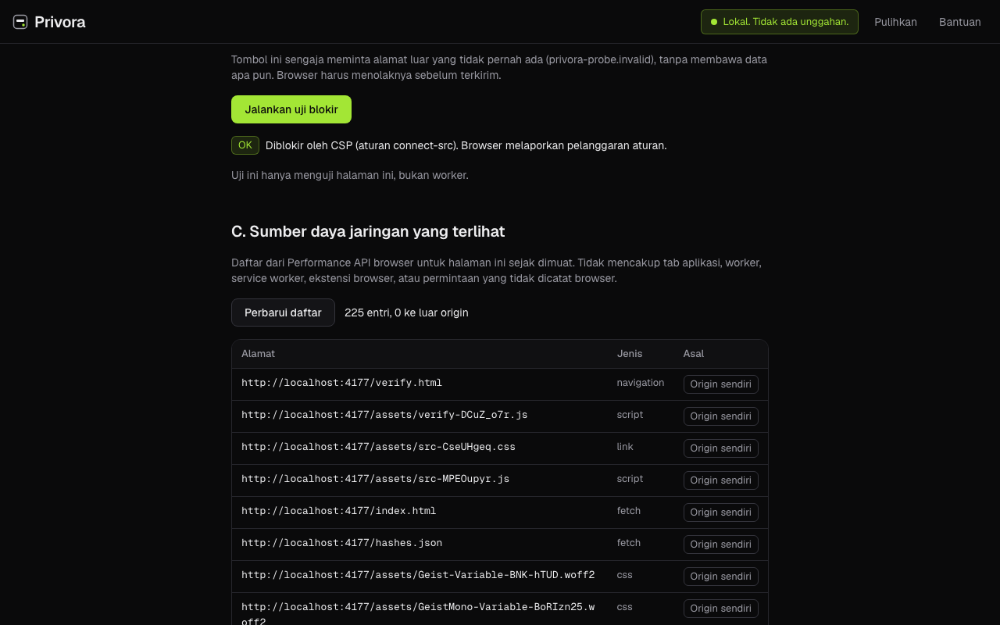
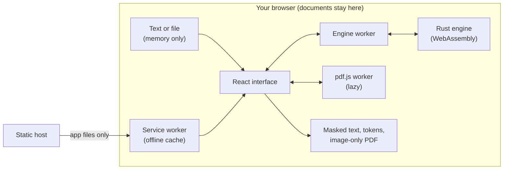

# Privora

Redact personal data in Indonesian-language documents, entirely in your browser. Paste text or open a file, a Rust
engine compiled to WebAssembly marks personal data, you review every finding, then you export a permanently masked
version or a tokenised version that can be restored after using it with an LLM.

> "Hitamkan NIK sebelum dokumenmu pergi ke mana-mana, tanpa mengunggah apa pun." (the interface is in Indonesian)



## Features

- **Detection**: NIK (with structural validation), KK, NPWP, Indonesian mobile numbers, e-mail addresses, payment
  card numbers, and (only after a label) names, addresses and birth dates.
- **Review**: check findings one by one, add or remove them, black out every occurrence of a value.
- **Two outputs**: permanent masking, or reversible tokens such as `[[NIK_1]]` with a local restore step and an
  optional passphrase-encrypted token map.
- **Input**: pasted text, `.txt`, `.md`, `.csv`, and PDFs with a text layer. PDF output is rebuilt from page images,
  with no hidden text.
- **Local**: no server, works offline after the first visit, and ships a verification page (`verify.html`).

## Screenshots

| Home | Result with tokens |
|---|---|
|  |  |

| PDF review | Verification page |
|---|---|
|  |  |

All data shown is invented.

## Read this first

1. Automatic detection is not perfect. Structured patterns (NIK, e-mail, phone) are more reliable; names and
   addresses are label-based heuristics only. You must review the results before sharing anything.
2. Privora helps you mask data. It is not a guarantee of legal anonymisation. Tokenisation is pseudonymisation:
   the token map contains the original personal data and must be treated as personal data.
3. "No upload" means the application code sends no data to the network. This can be checked through the CSP,
   offline mode, the verification page and reproducible builds. It says nothing about browser extensions,
   malware, or clipboard history on your device.
4. Accuracy figures come only from synthetic datasets, are labelled SINTETIS, and do not represent real documents.
5. PDFs without a text layer (scans) and images are not supported. OCR is a later stage.

## Quick start

Requirements: Rust 1.99.1 with the `wasm32-unknown-unknown` target (`rust-toolchain.toml`), Node 25.2.1
(`.nvmrc`), pnpm 10.34.9, `wasm-bindgen-cli` 0.2.130 and binaryen `version_133`.

```sh
cargo install wasm-bindgen-cli --version 0.2.130 --locked --root .tools
# unpack the binaryen version_133 release into .tools/binaryen
pnpm -C web install --frozen-lockfile
make verify              # checks, tests and production build
pnpm -C web preview      # serve web/dist with the security headers
```

Browser tests need Playwright's Chromium, once:
`PLAYWRIGHT_BROWSERS_PATH=$PWD/web/e2e/.browsers pnpm -C web exec playwright install chromium`, then `make ui-e2e`.

## How it works



| Path | Contents |
|---|---|
| `crates/privora-core` | Detection, redaction, tokenisation. Pure Rust, `#![forbid(unsafe_code)]` |
| `crates/privora-wasm` | wasm-bindgen wrapper |
| `tools/corpus-gen` | Synthetic labelled documents and the evaluator |
| `web/` | Vite, React, TypeScript, Tailwind |
| `scripts/` | Build, reproducibility and repository checks |

A NIK is checked for a known province code, non-zero district codes, a real birth date (women have 40 added to the
day) and a non-zero serial. It has no check digit, so a valid structure does not show that the number was ever
issued.

Tokens are numbered per kind and never collide with text already in the document. Restoring an unchanged tokenised
text gives back the original exactly. The saved map uses PBKDF2-SHA-256 (600,000 iterations) and AES-256-GCM, with
no passphrase recovery.

## Accuracy (SINTETIS)

400 generated documents from a seed never used for tuning. Templates and detectors have the same author, so expect
worse on real documents. Full report: [docs/EVALUATION.md](docs/EVALUATION.md).

| Kind | Precision | Recall |
|---|---|---|
| NIK | 95.8% | 100% |
| KK | 100% | 100% |
| NPWP | 96.7% | 100% |
| Phone | 99.7% | 100% |
| E-mail | 93.9% | 100% |
| Card | 79.0% | 100% |
| Name | 100% | **12.2%** (only labelled names are found) |
| Address | 97.0% | 97.0% |
| Birth date | 100% | 100% |

## Check the "no upload" claim

`verify.html` collects several checks, but it is run by the same code as the app, so it is not independent evidence.
These are:

1. **DevTools Network**: use the app with "Preserve log" on. Every request must go to the app's own origin and none
   may carry document content.
2. **Offline**: visit once, switch the network off, reload. Text and PDF flows must still work.
3. **Static check**: `node scripts/check-no-network.mjs` after a build. It is pattern matching and cannot see
   deliberately obfuscated calls.
4. **Reproduce the build**: `node scripts/hash-dist.mjs web/dist` and compare with the hash on `verify.html`.
   `scripts/repro-check.sh` builds twice and compares every file. This matched on one macOS arm64 machine; other
   systems have not been compared.

## Hosting

Serve `web/dist` from the root of its own origin over HTTPS and send the headers in `web/dist/_headers`. Without
them the workers run with no Content-Security-Policy.

## Limits

- Misses: unlabelled names, landline numbers, spaced 15 digit NPWP, e-mail with a non-ASCII local part, addresses
  beyond 160 characters, numbers split over lines or grouped with unusual separators.
- Over-marks: `icon@2x.png`, `git@host:repo`, Luhn-valid random numbers, 16 digit numbers near a NIK word.
- PDF: no OCR, no password protected files, annotation and form text is not scanned. Tested with synthetic files only.
- Browsers: tested with Playwright builds on macOS. Safari and phones are untested. The `Dockerfile` has not been run.
- "Bersihkan sesi" reloads the page. It does not clear the clipboard or downloaded files.
- No CSP protects against browser extensions, malware or a compromised host.

## Licence

MIT. Copyright (c) 2026 Vassel Goleyu. Third-party licences: [docs/DEPENDENCIES.md](docs/DEPENDENCIES.md).
